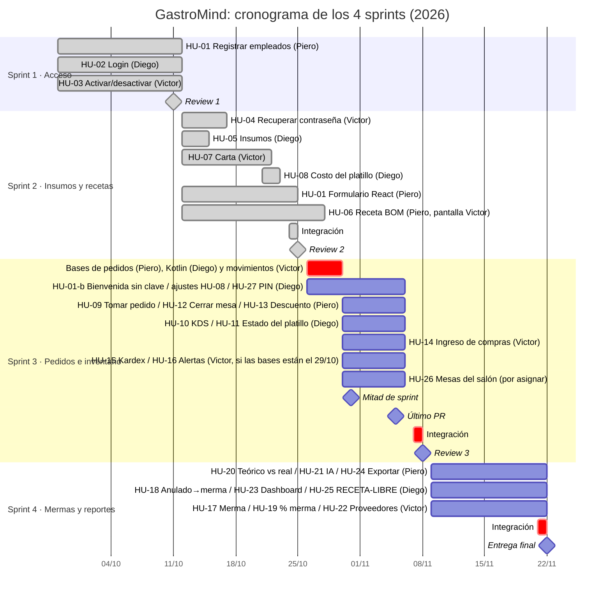

# Cronograma (Gantt)

Volver al [README](../README.md) · Modelo de datos: [`modelo_datos.md`](modelo_datos.md)

4 sprints de 2 semanas (lunes a domingo). Integración el sábado y Review el domingo de cierre. Lo gris ya está en `main`; las fechas de cierre de lo hecho son las del merge.

| Sprint | Fechas | Épicas |
|---|---|---|
| 1 | 28/09 – 11/10 | EP-01 Acceso y Seguridad |
| 2 | 12/10 – 25/10 | EP-02 Insumos y Recetas (+ HU-04 y el formulario de HU-01). La HU-06 se aceptó el 27/10 y la HU-01-b pasó al Sprint 3 |
| 3 | 26/10 – 08/11 | EP-03 Pedidos y Comanda + EP-04 Inventario |
| 4 (final) | 09/11 – 22/11 | EP-05 Mermas + EP-06 Compras y Reportes (+ HU-25) |

El Sprint 3 sigue la propuesta de la Planning 3 (28/10): bases el jue 29/10, mitad de sprint el sáb 31/10, último PR el jue 5/11, integración el sáb 7/11 y Review el dom 8/11. HU-15 y HU-16 van en Django y entran solo si las bases están el 29/10; si no, pasan al Sprint 4. El reparto del Sprint 4 se confirma en su Planning.
