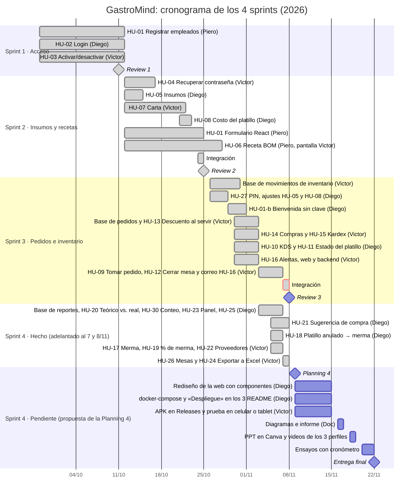

# Cronograma (Gantt)

Volver al [README](../README.md) · Modelo de datos: [`modelo_datos.md`](modelo_datos.md)

4 sprints de 2 semanas (lunes a domingo). Integración el sábado y Review el domingo de cierre. Lo gris ya está en `main`; las fechas de cierre de lo hecho son las del merge.

| Sprint | Fechas | Épicas |
|---|---|---|
| 1 | 28/09 – 11/10 | EP-01 Acceso y Seguridad |
| 2 | 12/10 – 25/10 | EP-02 Insumos y Recetas (+ HU-04 y el formulario de HU-01). La HU-06 se aceptó el 27/10 y la HU-01-b pasó al Sprint 3 |
| 3 | 26/10 – 08/11 | EP-03 Pedidos y Comanda + EP-04 Inventario |
| 4 (final) | 09/11 – 22/11 | EP-05 Mermas + EP-06 Compras y Reportes (+ HU-25) |

**Avance al lun 9/11.** Todo lo del Sprint 3 y lo adelantado del Sprint 4 (HU-17 a HU-26 y HU-30) está en `main`; las fechas son las del merge de cada PR. Lo pendiente del Sprint 4 sale de la propuesta del PO para la Planning 4: son fechas de trabajo, no de entrega, y la fecha final de entrega y sustentación **está por confirmar con el docente**. HU-15 y HU-16 de Django entraron en el Sprint 3. La aceptación del PO de las HU sigue pendiente (ver `Tareas.md`).
