# Modelo de datos (MER)

Volver al [README](../README.md) · Script: [`script_database.sql`](script_database.sql) · Migraciones: [`migraciones/`](migraciones/) · Datos de la demo: [`seed_demo.sql`](seed_demo.sql)

PostgreSQL 16, **una sola BD** para Spring y Django. Todas las tablas cuelgan de `restaurante` (multi-tenant) e ids en `BIGINT`. El esquema lo manda `script_database.sql` + `migraciones/`: Spring arranca con `ddl-auto=validate` y Django usa `managed = False`.

## Tablas (18)

| Tabla | Para qué | HU / épica | Sprint |
|---|---|---|---|
| `restaurante` | Tenant | EP-01 | 1 |
| `rol` | ADMINISTRADOR, COCINERO, ALMACENERO, MOZO | EP-01 | 1 |
| `empleado` | Personal, credenciales, estado, `version_token` (HL-035) | HU-01 a HU-04 | 1 |
| `historial_estado_empleado` | Quién activó o desactivó a quién | HU-03 | 1 |
| `token_recuperacion` | Enlace de recuperar contraseña (hash, caduca, un uso) | HU-04 | 2 |
| `categoria` | Platos, bebidas… por restaurante | HU-07 | 2 |
| `producto` | Platillo de la carta (precio, estado, `requiere_receta`) | HU-07 | 2 |
| `ingrediente` | Insumo + stock actual (kardex), `RECETA` / `LIBRE` | HU-05, HU-25 | 2 |
| `receta_detalle` | BOM producto ↔ insumo | HU-06 | 2 |
| `mesa` | Mesas por restaurante | HU-09, HU-12 | 3 |
| `pedido` / `pedido_detalle` | Comanda y estado de cada platillo | HU-09 a HU-12 | 3 |
| `registro_ingreso_proveedor` | Entradas de stock (lote, vencimiento) | HU-14, HU-16 | 3 |
| `conteo_ciclico` | Conteo físico de insumos LIBRE | HU-25 | 3–4 |
| `proveedor` / `proveedor_insumo` | Proveedores y precio por insumo | HU-22 | 4 |
| `motivo_merma` | Catálogo global + propio | HU-17 | 4 |
| `registro_merma` | Mermas reportadas | HU-17 a HU-19 | 4 |

El **kardex** no es una tabla aparte: es `ingrediente.stock_actual` más sus movimientos (`registro_ingreso_proveedor`, `registro_merma` y lo servido en `pedido_detalle` × `receta_detalle`).

## Diagrama entidad-relación

```mermaid
erDiagram
  restaurante ||--o{ empleado : tiene
  rol ||--o{ empleado : asigna
  empleado ||--o{ historial_estado_empleado : "cambia de estado"
  empleado ||--o{ token_recuperacion : pide
  restaurante ||--o{ categoria : tiene
  categoria ||--o{ producto : agrupa
  restaurante ||--o{ ingrediente : tiene
  producto ||--o{ receta_detalle : "se prepara con"
  ingrediente ||--o{ receta_detalle : "se usa en"
  restaurante ||--o{ mesa : tiene
  mesa ||--o{ pedido : recibe
  empleado ||--o{ pedido : "toma (mozo)"
  pedido ||--|{ pedido_detalle : contiene
  producto ||--o{ pedido_detalle : "se pide en"
  restaurante ||--o{ proveedor : tiene
  proveedor ||--o{ proveedor_insumo : ofrece
  ingrediente ||--o{ proveedor_insumo : "lo vende"
  restaurante |o--o{ motivo_merma : "propio (NULL = global)"
  motivo_merma ||--o{ registro_merma : clasifica
  ingrediente ||--o{ registro_merma : pierde
  empleado ||--o{ registro_merma : registra
  proveedor ||--o{ registro_ingreso_proveedor : entrega
  ingrediente ||--o{ registro_ingreso_proveedor : ingresa
  empleado ||--o{ registro_ingreso_proveedor : registra
  ingrediente ||--o{ conteo_ciclico : "se cuenta"
  empleado ||--o{ conteo_ciclico : registra

  restaurante {
    bigint id PK
    varchar nombre
  }
  rol {
    bigint id PK
    varchar nombre "ADMINISTRADOR COCINERO ALMACENERO MOZO"
  }
  empleado {
    bigint id PK
    bigint restaurante_id FK
    bigint rol_id FK
    varchar correo UK
    varchar password_hash
    varchar pin_acceso "hash, opcional"
    varchar estado "ACTIVO INACTIVO"
    int version_token
  }
  historial_estado_empleado {
    bigint id PK
    bigint empleado_id FK
    bigint cambiado_por FK
    varchar estado_anterior
    varchar estado_nuevo
  }
  token_recuperacion {
    bigint id PK
    bigint empleado_id FK
    varchar token_hash UK
    timestamp expira_en
    timestamp usado_en
  }
  categoria {
    bigint id PK
    bigint restaurante_id FK
    varchar nombre
  }
  producto {
    bigint id PK
    bigint categoria_id FK
    varchar nombre
    decimal precio
    boolean requiere_receta
    varchar estado
  }
  ingrediente {
    bigint id PK
    bigint restaurante_id FK
    varchar nombre
    varchar unidad_medida
    decimal stock_actual
    decimal stock_minimo
    decimal costo_unitario
    varchar tipo_control "RECETA LIBRE"
  }
  receta_detalle {
    bigint id PK
    bigint producto_id FK
    bigint ingrediente_id FK
    decimal cantidad_requerida
  }
  mesa {
    bigint id PK
    bigint restaurante_id FK
    int numero
    varchar estado
  }
  pedido {
    bigint id PK
    bigint mesa_id FK
    bigint empleado_id FK
    varchar estado
  }
  pedido_detalle {
    bigint id PK
    bigint pedido_id FK
    bigint producto_id FK
    int cantidad
    varchar estado
  }
  proveedor {
    bigint id PK
    bigint restaurante_id FK
    varchar nombre
  }
  proveedor_insumo {
    bigint id PK
    bigint proveedor_id FK
    bigint ingrediente_id FK
    decimal precio_unitario
    int tiempo_entrega_dias
  }
  motivo_merma {
    bigint id PK
    bigint restaurante_id FK
    varchar nombre
    boolean es_global
  }
  registro_merma {
    bigint id PK
    bigint empleado_id FK
    bigint ingrediente_id FK
    bigint motivo_id FK
    decimal cantidad
  }
  registro_ingreso_proveedor {
    bigint id PK
    bigint empleado_id FK
    bigint proveedor_id FK
    bigint ingrediente_id FK
    date fecha_vencimiento
    decimal cantidad_recibida
    decimal costo_total
  }
  conteo_ciclico {
    bigint id PK
    bigint empleado_id FK
    bigint ingrediente_id FK
    decimal cantidad_fisica_contada
  }
```

En el diagrama van las llaves y los campos que explican cada tabla; el detalle completo (tipos, `CHECK`, índices y triggers) está en el script.

## Reglas que pone la BD
- `CHECK` en los estados (`empleado`, `producto`, `mesa`, `pedido`, `pedido_detalle`) y en cantidades y precios.
- `UNIQUE` para no repetir: correo del empleado, insumo por restaurante, insumo en una receta, mesa por restaurante, precio por proveedor e insumo.
- Triggers `trg_receta_mismo_restaurante` y `trg_proveedor_insumo_mismo_restaurante`: una receta o un precio de proveedor no puede mezclar datos de dos restaurantes.
- Sin `ON DELETE` hacia `empleado` ni `producto`: se desactivan (`estado`), no se borran, para no perder el historial.
